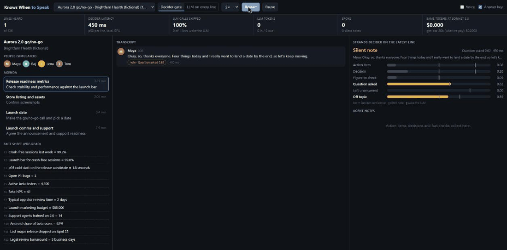
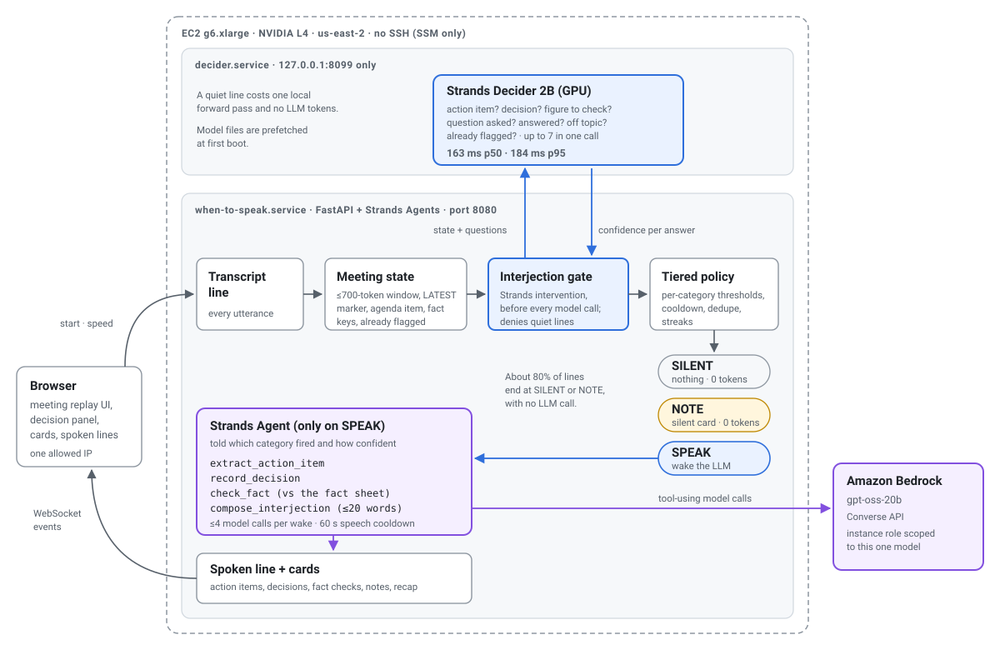

# Knows When to Speak

**A meeting agent that knows when to speak: a local 2B model screens every line, so the LLM
sees about one line in four and interrupts wrongly 3× less often.**

Meeting bots either never shut up or never help. This one listens to every utterance, and a
2B decision model ([Strands Decider](https://github.com/strands-labs/strands-decider)) decides
each time, in about 370 ms on a laptop GPU (RTX 3060, p95 430 ms), whether anything just happened that's worth waking an LLM for:

- someone **commits to an action** ("I'll send the deck to legal")
- the group **makes a decision**
- someone states a **number that contradicts the pre-read** ("crash-free is like 97%", but the sheet says 99.2%)
- a **question is left hanging**
- the meeting **drifts off the agenda**

Only then does an LLM (on Amazon Bedrock, or a local ollama model while prototyping) get called to write the few words the agent says.



Run the demo locally (Decider server on the GPU plus the app):

```bash
make serve                                   # terminal 1
python -m when_to_speak.app --port 8080      # terminal 2, then open http://127.0.0.1:8080
```

## Results

On the 16 test meetings, with `gpt-oss-20b` on Bedrock as the LLM ([full write-up](docs/RESULTS.md)):

| | Decider gates the LLM | LLM sees every line |
|---|---|---|
| Lines sent to the LLM | **27%** | 100% |
| LLM input tokens | **0.58M** | 2.31M |
| Unjustified spoken lines per meeting-hour | **7.7** | 25.8 |
| Off-topic drift caught | **35%** | 0% |
| Wrong figures corrected | 51% | **81%** |

On dev, the Decider answers in 366 ms p50 / 433 ms p95 on an RTX 3060 and fell for 0 of 44
planted action-item traps. An LLM judge (`gpt-oss-20b`) asked the same questions detects more
(higher F1 on every question), but takes 1.2 s p50 / 5.7 s p95 and fell for 18% of the traps.
The case for the Decider is speed, a flat latency tail, offline running, resistance to traps,
and tokens: priced at Claude Sonnet 5.5 on Bedrock, the gated agent costs about $1.00 per
meeting-hour vs $3.80 ungated.

> Tags: `#strands-decider-2b` `#policy`

## The reusable pattern

[`patterns/interjection_policy/`](patterns/interjection_policy/README.md) answers *"should my
agent speak now, and why?"* for any agent that watches a stream: meetings, Slack, support
chats, logs. It has typed questions, a confidence → SPEAK / NOTE / SILENT policy with a
cooldown, dedupe and streaks, a token-budgeted window, and a Strands `InterventionHandler`
that denies the model call (zero tokens) unless the gate says speak.

## How it works



```
utterance ─► MeetingState window (≤700 tokens, >> LATEST marker)
          ─► Strands Decider: 7 typed questions, one batched forward pass
          ─► TieredPolicy: SPEAK (wake Bedrock) │ NOTE (silent card) │ SILENT
          ─► Strands Agent (Bedrock) tools: extract_action_item, record_decision,
             check_fact, compose_interjection  ─► spoken line + UI card
```

Because a real meeting is hard to demo and has no ground truth, a **meeting simulator** writes
scripted but natural meetings from an agenda theme: personas with hidden agendas, a director
that plants events *and hard near-misses*, one LLM call per turn, an independent audit pass,
and timing. Every label comes by construction.

## Deploy on AWS

[`infra/`](infra/README.md) has a CDK stack that runs the whole demo on one GPU instance
(g6.xlarge, NVIDIA L4) with Bedrock for the LLM: no SSH, the app open to one IP only, and
`cdk destroy` removes everything. On the L4, Decider answers in 163 ms p50 / 184 ms p95.

See [`docs/VERIFIED_APIS.md`](docs/VERIFIED_APIS.md) for the Strands Decider and Strands Agents
API facts this is built on.

## Quickstart

```bash
make setup                      # venv, deps, CUDA torch
make test                       # unit + integration tests (no GPU/AWS needed)
make dataset                    # prebuilt meetings (data/authored) -> data/windows/{dev,test}.jsonl
make serve                      # Decider on 127.0.0.1:8099 (never expose it)
make smoke                      # the typed questions on hand-written windows

# LLM for the agent, recap and judge baseline: local ollama by default...
ollama pull qwen3:8b            # LLM_PROVIDER=ollama  OLLAMA_MODEL_MAIN=qwen3:8b
# ...or Bedrock for the real experiment
export LLM_PROVIDER=bedrock AWS_REGION=us-east-2 BEDROCK_MODEL_MAIN=<profile id> BEDROCK_MODEL_BASELINE=<id>

make eval-dev                   # Decider vs LLM judge on dev, calibration charts in docs/img/
make agent                      # headless agent over test meetings, event-level scores
python scripts/run_agent.py --split test --ungated   # baseline: the LLM sees every line
```

The eval set is prebuilt and committed; see [`docs/DATA.md`](docs/DATA.md) for how it was
written and labelled.

## License

Apache-2.0
